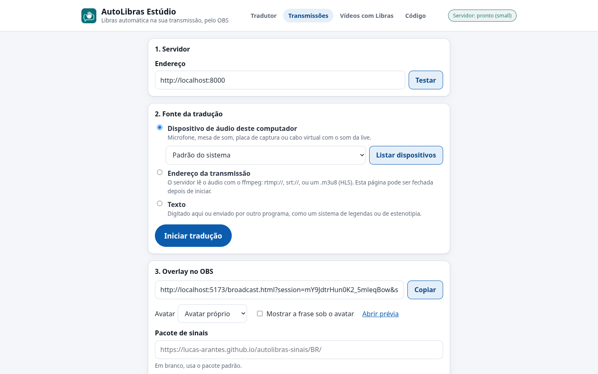
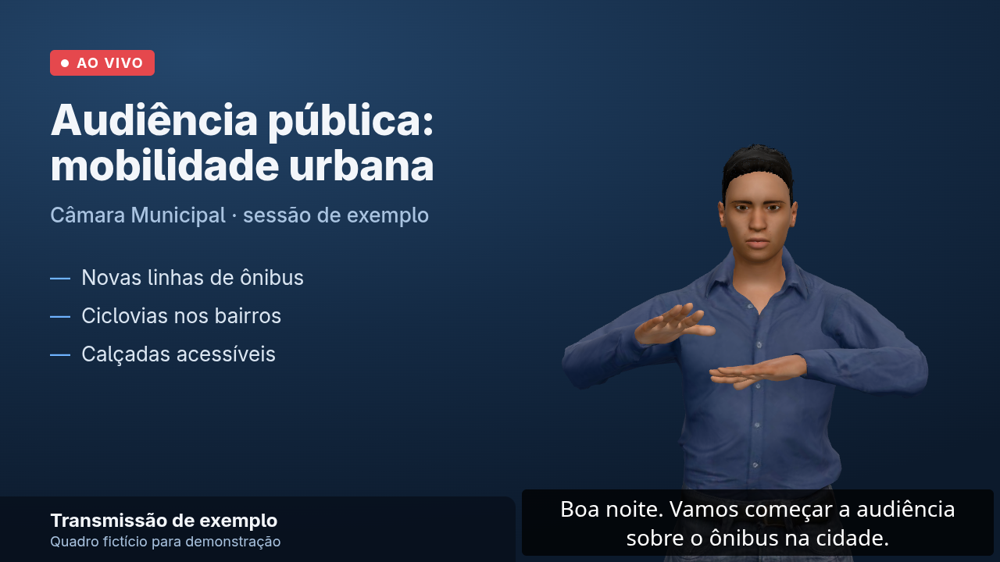

# Libras na sua live com o OBS

Este guia põe o avatar do AutoLibras numa transmissão feita com o OBS Studio. O servidor do AutoLibras ouve o áudio da live, transcreve a fala e manda as frases para uma página que o OBS mostra como fonte de navegador. Funciona no Windows, no macOS e no Linux.

> [!IMPORTANT]
> Use o avatar próprio do AutoLibras na live. Ele tem fundo transparente e não depende dos serviços do VLibras. O Estúdio também oferece o avatar do VLibras, mas os termos de uso do VLibras não autorizam tradução automática em produções audiovisuais, então ele serve só para testes. O player do VLibras ainda tem fundo cinza-claro, e o avatar aparece dentro de um retângulo.

> [!NOTE]
> O avatar automático complementa o intérprete de Libras, mas não o substitui. Na TV, a lei exige a janela com intérprete (Lei 13.146/2015, art. 67).

## O que você precisa

- [Docker Desktop](https://www.docker.com/products/docker-desktop/) no Windows ou no macOS. No Linux, o Docker Engine com o plugin `compose`.
- [OBS Studio](https://obsproject.com/) 28 ou mais recente.
- Internet: o overlay baixa os sinais do avatar do [pacote publicado](https://github.com/lucas-arantes/autolibras-sinais) (convertido do dicionário aberto do VLibras, GPL-3.0), só os que aparecem na live, e o tradutor local baixa uma vez a lista de sinais do VLibras. Para rodar sem internet, veja [Pacote de sinais local](#pacote-de-sinais-local).
- Espaço em disco para a imagem e para o modelo de reconhecimento de fala (o `small` tem cerca de 480 MB).

## 1. Suba o servidor

Crie uma pasta, salve nela o arquivo [`docker-compose.yml`](https://raw.githubusercontent.com/lucas-arantes/autolibras-tradutor/main/docker-compose.yml) e, nessa pasta, rode:

```bash
docker compose up -d
```

Na primeira vez, o Docker baixa a imagem pronta e o servidor baixa o modelo Whisper, o que leva alguns minutos. Depois disso, ele sobe em segundos e volta sozinho quando o computador reinicia. Para atualizar, rode `docker compose pull` e `docker compose up -d`.

Para montar a imagem a partir do código, na raiz do repositório, use `docker compose -f docker-compose.yml -f docker-compose.build.yml up -d --build`. Para usar uma GPU NVIDIA ou um servidor na internet, veja [Onde rodar o AutoLibras](hospedagem.md).

Para conferir, abra <http://localhost:8000/health>. Deve aparecer `"status":"ok"`.

## 2. Escolha a fonte no Estúdio

Abra <http://localhost:8000/studio.html> num navegador atualizado.



Em **Fonte da tradução**, escolha uma das opções:

- **Dispositivo de áudio deste computador**: o microfone de quem fala, a mesa de som ou a placa de captura. Clique em **Listar dispositivos** e escolha o certo. Se o som da live só existe dentro do OBS (vídeo, música, convidados), mande o monitor de áudio do OBS para um cabo virtual e escolha o cabo aqui: [VB-CABLE](https://vb-audio.com/Cable/) no Windows, [BlackHole](https://github.com/ExistentialAudio/BlackHole) no macOS e um `null-sink` do PipeWire ou do PulseAudio no Linux. A aba do Estúdio precisa ficar aberta durante a live.
- **Endereço da transmissão**: o servidor lê o áudio direto de um endereço `rtmp://`, `srt://` ou de uma playlist HLS (`.m3u8`), e o Estúdio pode ser fechado. Serve para quem tem o próprio servidor RTMP ou o endereço HLS da live. Um link de página, como `youtube.com/watch?v=…`, não funciona: é preciso o endereço do fluxo. Para testar com um vídeo gravado, marque **É um vídeo gravado**. Se a transmissão tem legenda, marque **Usar a legenda da transmissão**: o servidor lê a faixa WebVTT do HLS ou o closed caption (CEA-608) embutido no vídeo, que costuma ser mais fiel que o reconhecimento de fala.
- **Texto**: você digita as frases no Estúdio, ou outro programa (um sistema de legendas, uma estenotipia) as envia pela API. O Estúdio mostra o endereço para isso.

Clique em **Iniciar tradução**. Quando alguém falar, a transcrição aparece logo abaixo do botão.

## 3. Adicione o overlay no OBS

1. No Estúdio, em **Overlay no OBS**, clique em **Copiar**.
2. No OBS, em **Fontes**, clique em **+** e escolha **Navegador**.
3. Cole o endereço em **URL**. Com o avatar próprio, use **Largura** 400 e **Altura** 600; com o do VLibras, 260 e 380. Confirme.
4. Arraste a fonte para um canto da cena e amplie pelas bordas, se quiser.



O endereço do overlay não muda de uma live para outra, então esta etapa é feita uma vez só. Para trocar o avatar ou mostrar a frase embaixo dele, mude as opções no Estúdio e copie o endereço de novo.

## 4. Teste

Fale perto do microfone ou toque um vídeo. O avatar começa a sinalizar alguns segundos depois de cada frase: o servidor espera a pausa no fim da frase, transcreve, e o tradutor gera a glosa. Num teste em CPU com o modelo `small` e o avatar próprio, o primeiro sinal saiu cerca de 2 segundos depois do fim da fala; com o avatar e o tradutor do VLibras, cerca de 3 segundos. Quando a fala é rápida, as frases entram numa fila e o avatar acelera um pouco para não ficar para trás.

Na fala corrida, sem pausas, cada frase sai assim que termina com ponto, interrogação ou exclamação, sem esperar o fim da fala.

Para encerrar, clique em **Parar** no Estúdio. O avatar para de sinalizar e volta a funcionar sozinho na próxima vez que você iniciar, sem mexer no OBS.

## Live com a janela de Libras embutida (YouTube, Twitch)

Em vez do overlay no OBS, o servidor pode receber a live do OBS, juntar a janela de Libras ao vídeo e mandar o resultado para a plataforma. A live sai alguns segundos atrasada, e esse atraso faz o sinal aparecer junto com a fala, sem configurar nada no OBS.

1. No Estúdio, em **Fonte da tradução**, escolha **Transmissão enviada pelo OBS (RTMP)**.
2. Em **Janela de Libras no vídeo**, marque **Enviar a transmissão com a janela de Libras** e cole em **Para onde enviar** o servidor e a chave de transmissão da plataforma, juntos: no YouTube, por exemplo, `rtmp://a.rtmp.youtube.com/live2/` seguido da chave. Escolha o lado, a altura e o fundo da janela.
3. Clique em **Iniciar tradução**. O Estúdio mostra um servidor e uma chave.
4. No OBS, em **Configurações → Transmissão**, escolha o serviço **Personalizado**, cole o servidor e a chave do Estúdio e inicie a transmissão.

A plataforma recebe a live com o atraso escolhido (8 segundos, por padrão) e com a janela no canto. O atraso precisa cobrir o tempo que a fala leva para virar sinal: o Estúdio mostra quanto as frases estão levando. Se a transmissão já vai para um servidor RTMP, SRT ou HLS seu, use **Endereço da transmissão** como fonte em vez do RTMP do OBS.

Juntar a janela pesa no processador: o servidor desenha o avatar e codifica o vídeo de novo, além de reconhecer a fala. Num computador doméstico, use 720p e deixe o servidor numa máquina diferente da do OBS, se puder. Cada servidor faz uma composição por vez, e a porta 1935 precisa estar livre.

## Modo sincronizado

No modo normal, o avatar sinaliza alguns segundos depois da fala. Se o seu sistema de produção consegue atrasar o vídeo e o áudio da transmissão sem atrasar o overlay, o avatar pode sinalizar junto com a fala: marque **Modo sincronizado** no Estúdio e informe o atraso, em segundos. O overlay passa a começar cada frase esse tanto depois de ela ter sido dita.

O atraso precisa cobrir o tempo de processamento. Durante a sessão, o Estúdio mostra quanto as frases estão levando e sugere um valor. Se uma frase ficar pronta depois da hora, o avatar a sinaliza assim que puder.

O OBS sozinho não tem um jeito simples de atrasar o vídeo e o áudio de uma cena por vários segundos. Sem esse atraso no sistema de produção, deixe o modo desligado.

## Problemas comuns

**O overlay não mostra nada.** Acrescente `&status=1` ao fim do endereço do overlay, na fonte do OBS, para ver o estado da conexão. "A sessão ainda não começou" quer dizer que falta clicar em **Iniciar tradução** no Estúdio. Um erro ao carregar o avatar costuma ser falta de internet para baixar os sinais.

**Uma palavra sai soletrada.** O sinal dela não está no pacote, então o avatar faz a datilologia. O dicionário inteiro do VLibras tem cerca de 23 mil sinais; um pacote menor soletra mais palavras.

**O avatar fica muito atrás da fala.** O computador não está dando conta do modelo. Use um modelo menor: pare o servidor e suba de novo com `AUTOLIBRAS_MODEL=base docker compose up -d`. Fechar programas pesados também ajuda.

**O OBS está em outro computador.** No `docker-compose.yml`, troque `"127.0.0.1:8000:8000"` por `"8000:8000"` e defina uma senha com `AUTOLIBRAS_TOKEN=uma-senha-longa docker compose up -d`. No OBS, use o endereço do computador do servidor no overlay, como `http://192.168.0.10:8000/broadcast.html?...`. O overlay não pede senha: o id no endereço já funciona como chave. O Estúdio que capta o áudio deve ficar aberto no próprio computador do servidor, em `localhost`: o navegador só libera o microfone em `localhost` ou em páginas com HTTPS. As fontes de endereço e de texto funcionam de qualquer computador da rede.

**Pacote de sinais local.** Para não depender da internet, ou para usar outra versão do pacote, baixe o [pacote de sinais](https://github.com/lucas-arantes/autolibras-sinais), ponha-o numa pasta `sinais` ao lado do `docker-compose.yml`, com o `manifest.json` direto em `sinais/manifest.json`, descomente a linha `./sinais:/signs:ro` no arquivo e rode `docker compose up -d` de novo. O Estúdio passa a usar esse pacote.

**O endereço do overlay vazou.** Clique em **Gerar outro endereço** no Estúdio e cole o novo no OBS.

## Como funciona

```text
áudio da live ─► Estúdio (navegador) ─┐
                                       ├► servidor AutoLibras ─► overlay no OBS
endereço RTMP/SRT/HLS ─► ffmpeg ──────┘   (Whisper, por sessão)   (glosa + avatar)
```

O servidor guarda cada transmissão como uma sessão. O áudio de uma sessão chega pelo Estúdio ou pelo ffmpeg, e o servidor manda as frases a todos os overlays conectados a ela. A tradução para glosa e o avatar rodam no próprio overlay. A API das sessões está descrita em [`services/stt-server/README.md`](../services/stt-server/README.md).
